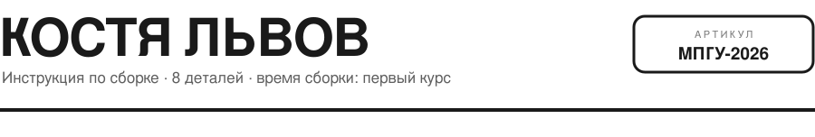
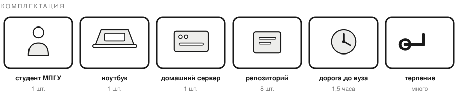
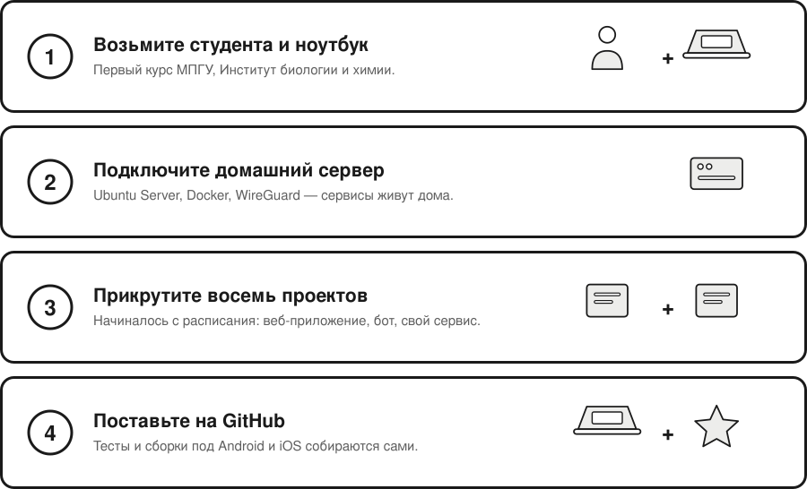

<picture>
  <source media="(prefers-color-scheme: dark)" srcset="assets/manual-header-dark.svg">
  
</picture>

<picture>
  <source media="(prefers-color-scheme: dark)" srcset="assets/manual-parts-dark.svg">
  
</picture>

<picture>
  <source media="(prefers-color-scheme: dark)" srcset="assets/manual-steps-dark.svg">
  
</picture>

<picture>
  <source media="(prefers-color-scheme: dark)" srcset="assets/manual-warning-dark.svg">
  
</picture>

### Детали в комплекте

| | Деталь | Назначение |
|:--|:--|:--|
| **A** | [mpgu-timetable](https://github.com/lvovkonstantin57-del/mpgu-timetable) | `Python` `FastAPI` `Capacitor` — расписание вуза: пары, напоминания, объявления старост, посещаемость по коду. Сайт [mpgu-timetable.ru](https://mpgu-timetable.ru), сборки под Android и iOS |
| **B** | [StichOS](https://github.com/lvovkonstantin57-del/stich-os) | `FastAPI` `JavaScript` `D3.js` — веб-ОС домашнего сервера: окна, Dock, вход по passkey |
| **C** | [Business Card API](https://github.com/lvovkonstantin57-del/business-card-api) | `NestJS` `GraphQL` `Prisma` `PostgreSQL` — цифровая визитка в виде GraphQL API |
| **D** | [Stich AI Chat](https://github.com/lvovkonstantin57-del/stich-ai-chat) | `FastAPI` `JavaScript` — кнопка «спросить меня» в футере сайта, OpenAI-совместимый API |
| **E** | [MPGU Schedule Bot](https://github.com/lvovkonstantin57-del/mpgu-schedule-bot) | `aiogram 3` `aiohttp` `SQLite` — бот и мини-приложение с расписанием |
| **F** | [Stich Portfolio](https://github.com/lvovkonstantin57-del/stich-portfolio) | `React` `Vite` `Python` — личный сайт с маскотом |
| **G** | [Internet Spend](https://github.com/lvovkonstantin57-del/internet-spend) | `Python stdlib` — учёт подписок и связи, ноль зависимостей |
| **H** | [tg-webapp](https://github.com/lvovkonstantin57-del/tg-webapp) | `HTML` `CSS` `JavaScript` — первая версия расписания как Telegram WebApp |

<picture>
  <source media="(prefers-color-scheme: dark)" srcset="assets/manual-support-dark.svg">
  
</picture>

**Связаться:** [Telegram @l1ttleStich](https://t.me/l1ttleStich) · [lvovkonstantin57@gmail.com](mailto:lvovkonstantin57@gmail.com)
