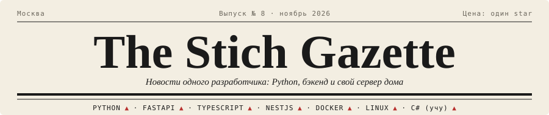
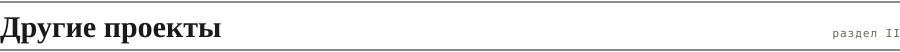

<picture>
  <source media="(prefers-color-scheme: dark)" srcset="assets/masthead-dark.svg">
  
</picture>

<table>
<tr>
<td width="68%" valign="top">

<picture>
  <source media="(prefers-color-scheme: dark)" srcset="assets/headline-dark.svg">
  
</picture>

**П**роект прошёл три версии: от мини-приложения в Telegram к боту и, наконец, к самостоятельному сервису **mpgu-timetable**. Пары, напоминания, объявления старост и отметка посещаемости по коду теперь в одном месте, а сборки под Android и iOS собираются автоматически.

[**Читать дальше → mpgu-timetable**](https://github.com/lvovkonstantin57-del/mpgu-timetable)

</td>
<td width="32%" valign="top">

<picture>
  <source media="(prefers-color-scheme: dark)" srcset="assets/h-author-dark.svg">
  
</picture>

**Константин Львов**, студент первого курса МПГУ. Пишет на Python, держит домашний сервер `stich-server` и собирает сервисы, которыми пользуются однокурсники.

ЦИТАТА НОМЕРА

> *«Если сервис можно поднять у себя дома — я подниму»*

</td>
</tr>
</table>

<picture>
  <source media="(prefers-color-scheme: dark)" srcset="assets/h-projects-dark.svg">
  
</picture>

<table>
<tr>
<td width="33%" valign="top">
<code>FASTAPI · D3.JS · OLLAMA</code> 
<b><a href="https://github.com/lvovkonstantin57-del/stich-os">StichOS</a></b> 
Веб-ОС для домашнего сервера: окна, Dock, Spotlight прямо в браузере.
</td>
<td width="33%" valign="top">
<code>NESTJS · PRISMA · POSTGRESQL</code> 
<b><a href="https://github.com/lvovkonstantin57-del/business-card-api">Business Card API</a></b> 
Цифровая визитка в виде GraphQL API: профиль, навыки, проекты.
</td>
<td width="33%" valign="top">
<code>FASTAPI · JS</code> 
<b><a href="https://github.com/lvovkonstantin57-del/stich-ai-chat">Stich AI Chat</a></b> 
Кнопка «спросить меня» в футере сайта, отвечает нейросеть.
</td>
</tr>
<tr>
<td width="33%" valign="top">
<code>AIOGRAM · AIOHTTP · SQLITE</code> 
<b><a href="https://github.com/lvovkonstantin57-del/mpgu-schedule-bot">MPGU Schedule Bot</a></b> 
Бот регистрирует студентов по ФИО, мини-приложение показывает расписание.
</td>
<td width="33%" valign="top">
<code>REACT · VITE · FASTAPI</code> 
<b><a href="https://github.com/lvovkonstantin57-del/stich-portfolio">Stich Portfolio</a></b> 
Личный сайт с маскотом и встроенным редактором контента.
</td>
<td width="33%" valign="top">
<code>PYTHON STDLIB</code> 
<b><a href="https://github.com/lvovkonstantin57-del/internet-spend">Internet Spend</a></b> 
Учёт подписок и связи: сколько уходит в месяц и в год.
</td>
</tr>
<tr>
<td width="33%" valign="top">
<code>HTML · CSS · JS</code> 
<b><a href="https://github.com/lvovkonstantin57-del/tg-webapp">tg-webapp</a></b> 
Первая версия расписания как Telegram WebApp.
</td>
<td></td>
<td></td>
</tr>
</table>

<picture>
  <source media="(prefers-color-scheme: dark)" srcset="assets/divider-dark.svg">
  
</picture>

<table>
<tr>
<td width="50%" valign="top">

<picture>
  <source media="(prefers-color-scheme: dark)" srcset="assets/h-announce-dark.svg">
  
</picture>

Открыт к стажировкам в бэкенде. Пишите в Telegram [@l1ttleStich](https://t.me/l1ttleStich) или на lvovkonstantin57@gmail.com.

</td>
<td width="50%" valign="top">

<picture>
  <source media="(prefers-color-scheme: dark)" srcset="assets/h-next-dark.svg">
  
</picture>

Как студент учит C# и что из этого выйдет.

</td>
</tr>
</table>
